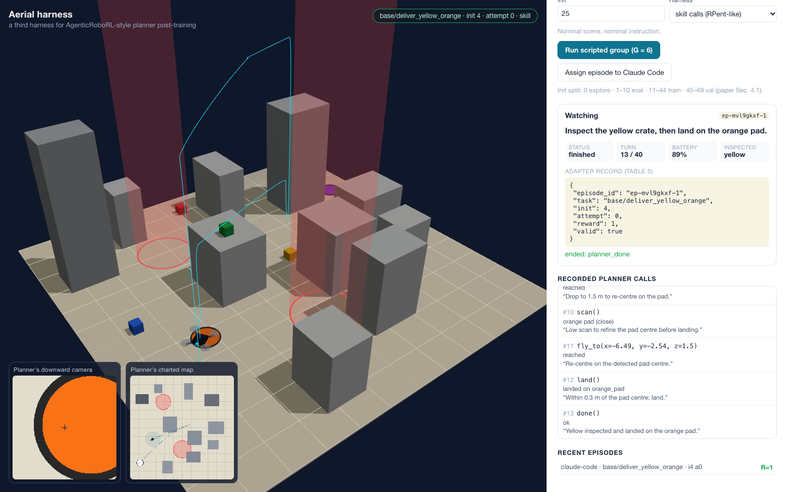

# Aerial harness: a drone sim for planner post-training

A deterministic, headless quadrotor simulator built as a **third harness for
[AgenticRoboRL](https://arxiv.org/abs/2610.28589)**-style planner
post-training. A language-model planner flies language-specified search,
inspect and deliver missions in a 3D city block, through either **skill
calls** (RPent-like) or **generated control code** (CaP-X-like). Flight
control, perception and the success check stay frozen. Every episode ends in
the paper's five-field adapter record, and group rollouts become RLOO training
samples.



> **Problem statement and research questions:** [`docs/PROBLEM_STATEMENT.md`](docs/PROBLEM_STATEMENT.md)

## Quick start

```bash
cd drone-sim
npm install          # optional: only the 3D viewer uses three.js; without it the viewer loads it from jsDelivr (needs internet)
npm test             # 19 tests, no network, ~3 s
npm start            # http://127.0.0.1:8095
```

In the viewer, click **Run scripted group (G = 6)** to watch six sampled
attempts on one (task, init) and see their rewards and leave-one-out
advantages. Or click **Assign episode to Claude Code** and start a planner
(see below).

One RL round's worth of data, headless:

```bash
node tools/rollout.mjs --split train --group 6 --suites base,wind
node tools/rollout.mjs --split eval  --group 6 --suites all --harness code
```

## How it maps onto the paper

| AgenticRoboRL | Here |
|---|---|
| Planner `π_θ` (trainable) | Claude Code, any OpenAI-compatible model via `planners/llm_planner.mjs`, or the scripted reference planner |
| Robot harness, frozen executor | `sim/world.mjs`: straight-line position controller (`fly_to` does **not** avoid obstacles), noisy downward detector, seeded wind |
| VLA skill invocation (RPent) | **skill harness**: one call per turn among `takeoff`, `fly_to`, `move`, `hover`, `scan`, `land`, `done` |
| Control-code generation (CaP-X) | **code harness**: one program per turn against the same primitives (`node:vm`, timeout, call cap) |
| Model-call proxy (Fig. 2b) | `proxy.mjs`: OpenAI-compatible pass-through that records request, response and logprobs, tagged with `x-episode-id` and `x-turn` |
| Harness adapter, Table 5 | `Episode.adapterRecord`: `{episode_id, task, init, attempt, reward, valid}` |
| Reward = simulator success check | `Episode.success()`: inspected crates plus landed on the right pad, no violation. `done()` only ends the episode |
| `valid = false` for infrastructure | model-server errors, planner unreachable for 10 min, simulator exceptions |
| Group = task × initial state | the world depends on `init` (and suite) only. Attempts vary only in the planner |
| RLOO advantage, Eq. 4 / ≤16 responses, Eq. 5 | `sim/rloo.mjs` |
| LIBERO-PRO S / T, LIBERO-Plus categories | suites `swap`, `task`, `language`, `wind`, `noise`, `light`, `layout` |
| Init split 0 / 1–10 / 11–44 / 45–49 | `SPLITS` in `sim/tasks.mjs` |

## The task

The map charts the buildings (boxes with heights) and the no-fly zones
(cylinders at every altitude). Crates and the orange and purple pads are
**not** charted, so the planner has to find them with `scan()`:

- The camera footprint radius is `0.75·(altitude above surface) + 0.5` m.
  High scans see far but detect unreliably and with noise.
- A crate counts as **inspected** when scanned from at most 1.5 m
  horizontally and at most 4 m above its surface. The green crate sits on a
  rooftop.
- Landing on a pad requires being within 0.8 m of its centre.
- Collisions, no-fly-zone entry, leaving the geofence and an empty battery
  end the episode with reward 0.

## Planner API (HTTP)

| Method | Path | |
|---|---|---|
| `POST` | `/api/episodes` | `{task, suite, init, attempt, harness, planner, run, policy_version}` → briefing (instruction, map, skills, limits, first observation) |
| `POST` | `/api/episodes/:id/act` | skill harness: `{skill, args, reasoning}` → feedback + observation (+ `result` when the episode ends) |
| `POST` | `/api/episodes/:id/code` | code harness: `{code, reasoning}` → error, logs, call trace, observation |
| `POST` | `/api/episodes/:id/abort` | `{reason}` → marks an infrastructure failure (`valid = false`) |
| `GET` | `/api/episodes/:id/camera.png` | downward camera, rendered server-side |
| `GET` | `/api/episodes/:id/map.png` | charted map with the trail |
| `GET` | `/api/assignment` | the episode the teacher assigned to Claude Code |
| `GET` | `/api/meta` | tasks, suites, splits, limits |

`/spectator/*` serves ground truth to the viewer. It is not part of the planner
surface, and the agent brief forbids it.

## Planners

**Claude Code.** Start `claude` in `drone-sim/`, hand it
[`CLAUDE_AGENT_BRIEF.md`](CLAUDE_AGENT_BRIEF.md), and click *Assign episode
to Claude Code*. Its actions and one-line reasoning are recorded at the
harness boundary. Claude Code's internal model calls cannot be proxied, so it
serves as teacher or reference, not as the RL student.

**An open model (the paper's setting).** Serve the student with vLLM, put the
recording proxy in front of it, and roll out groups:

```bash
vllm serve Qwen/Qwen3.5-9B --port 8000 --enable-auto-tool-choice --tool-call-parser hermes
UPSTREAM=http://127.0.0.1:8000 RUN=round0 RECORD_LOGPROBS=1 node proxy.mjs     # :8090
npm start                                                                       # :8095
node planners/llm_planner.mjs --task deliver_yellow_orange --init 11 --attempts 6 \
  --run round0 --model Qwen/Qwen3.5-9B --base-url http://127.0.0.1:8090/v1
```

Use the tool-call parser that matches your model. `runs/round0/` then holds
`proxy_calls.jsonl` (token-level, for the trainer), `calls.jsonl` (harness
level), and `adapter.jsonl`, all joined on `episode_id`.

**Scripted reference planner** (`planners/scripted.mjs`). It is a
self-contained strategy whose seed stands in for sampling temperature: it
decides cruise altitude, whether to route around no-fly zones, and whether to
correct for wind. The *same function* is driven turn by turn through the skill
harness, or serialized and submitted as one program to the code harness.

## Run outputs (`runs/<run>/`)

| File | One row per | Contents |
|---|---|---|
| `adapter.jsonl` | episode | the five Table 5 fields plus `episode_id` |
| `episodes.jsonl` | episode | end reason, turns, battery, inspected, landed_on, harness, planner, policy version |
| `calls.jsonl` | planner turn | context observation, response (skill + args, or code), reasoning, feedback |
| `briefings.jsonl` | episode | the initial context (instruction, map, skills, limits) |
| `rl_samples.jsonl` | selected turn | full multi-turn context reference, response, RLOO advantage, weight `1/K` |
| `proxy_calls.jsonl` | model call | exact request (messages, tools, sampling) and response (choices, logprobs) |

## Reference planner baseline (eval split, G = 6, % success)

| Harness | base | swap | task | language | wind | noise | light | layout | overall |
|---|---|---|---|---|---|---|---|---|---|
| skill | 42.3 | 48.8 | 52.5 | 42.3 | 16.7 | 16.7 | 17.3 | 34.4 | 33.9 |
| code | 42.3 | 48.8 | 52.5 | 42.3 | 16.7 | 16.7 | 17.3 | 34.4 | 33.9 |

The two harnesses give identical rewards in all 3,840 episodes, because the
plan is identical and only the execution mechanism differs. See `docs/PROBLEM_STATEMENT.md` §6 for how to read the
table.

## Limitations

- The flight model is kinematic, with no attitude dynamics. The detector is a
  noisy oracle, and the camera is an orthographic top-down render.
- `node:vm` is not a security boundary. Run the code harness only locally
  with planners you control.
- No model has been post-trained here yet. This is the environment, adapter,
  data pipeline and baselines.

## Files

```
server.mjs              HTTP harness + spectator endpoints + static viewer
proxy.mjs               OpenAI-compatible recording proxy (model-call proxy)
sim/world.mjs           world generation, flight physics, detector
sim/harness.mjs         Episode: skill + code harnesses, recording, success, adapter
sim/tasks.mjs           tasks, perturbation suites, init split, instructions
sim/rloo.mjs            Eq. 4 advantages, Eq. 5 sample selection
sim/render.mjs          PNG encoder + camera / map rasteriser (no native deps)
sim/recorder.mjs        JSONL run storage
planners/scripted.mjs   stochastic reference planner (both harnesses)
planners/llm_planner.mjs  OpenAI-compatible planner (tools or code blocks)
tools/rollout.mjs       headless group rollouts -> summary + RL samples
public/                 three.js spectator viewer
test/                   node:test unit + HTTP integration tests
```
